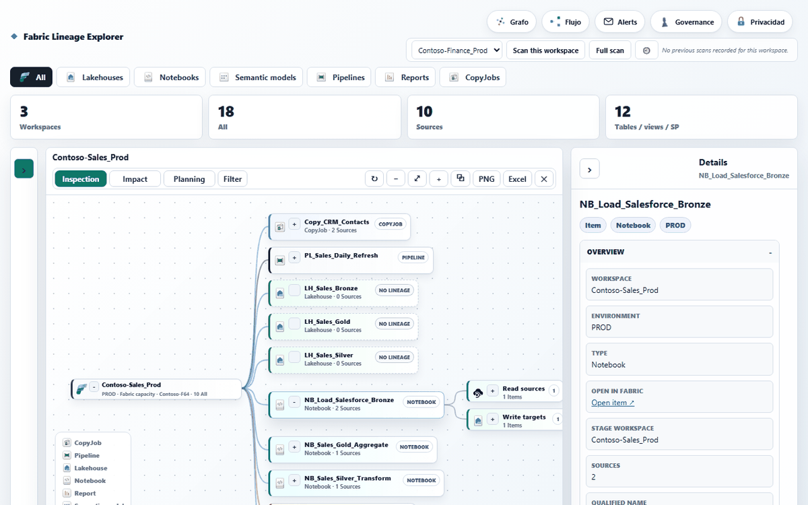
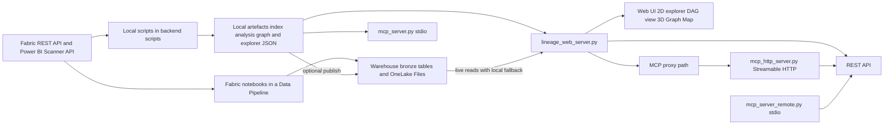

<div align="center">

# LineageIQ

**A read-only lineage, catalogue and governance mapper for Microsoft Fabric, with a 2D/3D graph UI, a REST API and MCP servers for AI agents.**

[](https://github.com/LargoLujan/lineageiq/actions/workflows/ci.yml)
[](https://github.com/LargoLujan/lineageiq/pkgs/container/lineageiq)
[](LICENSE)


<br>



<sub>Running on the built-in synthetic demo tenant (fictional Contoso data).</sub>

</div>

Microsoft Fabric shows lineage at item level, and Microsoft Purview documents only item-level lineage for Fabric items other than Power BI, so questions such as "which notebooks write this table" or "what breaks if this view changes" are hard to answer. LineageIQ discovers every workspace and item it can read, extracts dependencies from notebook code, pipeline definitions and semantic model TMDL down to the source-object level (tables, views, stored procedures, files), and serves the result as an interactive graph, a governance panel, a REST API and Model Context Protocol (MCP) tools. Discovery is strictly read-only. The project is at an early stage (version 0.2.0); it ships with a synthetic demo tenant so you can run it without any Fabric access, in one command with Docker:

```bash
docker run --rm -p 8765:8765 ghcr.io/largolujan/lineageiq:latest
```

Then open `http://localhost:8765`. See [Try the Demo Image](#try-the-demo-image) for the MCP tools.

## Table of Contents

- [Overview](#overview)
- [Key Features](#key-features)
- [How It Works](#how-it-works)
- [Tech Stack](#tech-stack)
- [Project Structure](#project-structure)
- [Getting Started](#getting-started)
  - [Prerequisites](#prerequisites)
  - [Installation](#installation)
  - [Try the Demo Image](#try-the-demo-image)
  - [Quick Start With Demo Data](#quick-start-with-demo-data)
  - [Pointing It at Your Own Tenant](#pointing-it-at-your-own-tenant)
  - [Running With Docker](#running-with-docker)
- [Usage](#usage)
  - [Web Interface](#web-interface)
  - [Discovery Scripts](#discovery-scripts)
  - [Fabric Notebooks](#fabric-notebooks)
  - [REST API](#rest-api)
  - [MCP Servers](#mcp-servers)
- [Configuration](#configuration)
  - [Admin Settings File](#admin-settings-file)
  - [Environment Variables](#environment-variables)
  - [Server Options](#server-options)
- [Documentation](#documentation)
- [Known Limitations](#known-limitations)
- [Testing](#testing)
- [Publishing Your Own Fork](#publishing-your-own-fork)
- [License](#license)
- [Author](#author)

## Overview

LineageIQ maps a Microsoft Fabric tenant into one read-only graph: workspaces, items (lakehouses, warehouses, notebooks, data pipelines, copy jobs, dataflows, semantic models, reports and more), the source objects they read or write, execution history, schedules and workspace role assignments. Every node is identified by a readable qualified name, `Workspace / Item Type / Item Name`, with Fabric GUIDs kept only as metadata.

There are two ways to run discovery, and both feed the same viewer:

- **Locally**, with the numbered PowerShell and Python scripts in `backend/scripts/` (authenticating through the Azure CLI or Fabric CLI), which write CSV and JSON artefacts to the repository folders.
- **Inside Fabric**, with the notebooks in `fabric_notebooks/` chained in a Fabric Data Pipeline, which write `dbo.bronze_*` tables to a Warehouse and the explorer JSON to a Lakehouse's OneLake `Files/generated/` folder.

`backend/scripts/lineage_web_server.py` then serves the web UI, a secured `/api/*` REST surface and a `/mcp` endpoint from one host and port.

**Read-only by design.** No discovery script writes to the Fabric items, Azure DevOps, SharePoint or OneLake data it scans. Any operational change is proposed as text for a human to review and apply, never executed automatically. The only writes are opt-in, admin-initiated actions on targets you designate: publishing LineageIQ's own results to a Warehouse or OneLake folder, triggering its discovery pipeline, and the admin-only installer that provisions LineageIQ's own workspace and notebooks in a tenant.

## Key Features

- **Catalogue and lineage**: workspace and item inventory, an item-level dependency graph and, where it can be extracted from notebook code, pipeline definitions or TMDL, object-level lineage to tables, views, stored procedures and files. Each edge carries a relationship type (`reads_from`, `writes_to`, `executes`, `refreshes`, `depends_on`, `uses_model`, `serves_report`, `contains`) and a confidence level (`confirmed`, `likely`, `unknown`).
- **Operational context**: execution history and duration statistics, failure hotspots, configured schedules, deployment pipelines and their stages, workspace role assignments and Fabric connections.
- **Graph visualisation**: a 2D flow explorer with lineage, impact and planning views; a DAG view anchored on one asset and laid out with dagre; and a WebGL 3D "Graph Map" mode at item and object level, built on `3d-force-graph` and Three.js. The `frontend/semantic-lineage/graph-map.js` header records why: profiling showed the earlier Cytoscape.js canvas renderer averaging under 1 FPS on a real tenant's graph, while the WebGL engine held 60 FPS on the same data.
- **Governance panel**: sensitivity labels, endorsement and certification, tags and semantic model row-level security roles, sourced from the Power BI/Fabric Admin Scanner API, plus column-level security and dynamic data masking read from SQL endpoints. When a permission is missing, the panel shows a specific diagnostic and the fix instead of a blank view.
- **Data quality rules**: a small admin-defined rule engine (`Null % at most`, `Distinct values at least`, `Rows at least`) evaluated against the column-profile data the scans already collect, with no new scan and no new permission (`backend/scripts/lineage_web/data_quality.py`).
- **Configurable sensitivity classifiers**: 22 built-in column-name pattern categories (`backend/scripts/lineage_web/sensitivity_classifier.py`), including email, phone, national ID, financial, health, biometric, academic record, disciplinary record, guardian and family data, employment, insurance, marketing consent, AI-processing flags and third-party sharing, each tagged with risk level and legal frameworks (GDPR, GDPR special category, GDPR criminal data, FERPA, CCPA). Admins can add custom regex categories without touching code. A separate notebook adds content-verified matches from a bounded sample of real values, storing match percentages, never the values.
- **Data products**: an admin-curated, cross-workspace grouping of items into Purview Unified Catalog-style products (name, owner, description, linked items). They are deliberately not called "domains", because Fabric already has a native per-workspace domain field that this coexists with.
- **Privacy locator**: an admin-only Privacy panel that answers "where might this kind of personal data live in Fabric", with one row per flagged table listing every matched category and a maximum risk level, a browse-by-legal-framework view and an admin-maintained list of known external systems per category. It is a locator, not a personal-data puller: the project never reads or indexes row-level personal data, so it can say a table might hold disciplinary records but never return a specific person's row. Results are cached server-side for 120 seconds.
- **Collaboration and curation**: comments and favourites on any node, a business glossary, certified items and free-form tags.
- **Admin panel**: tenant and sign-in settings, allowed users, active sessions, API keys, write storage, Fabric-native scan, OneLake explorer data, external sources, email and Teams notifications, capacity insight, a per-scan change digest and usage analytics.
- **Scan control from the web**: single-workspace, full-tenant and execution-only scans, queued (up to 20 requests) when a scan is already running, with live progress polling and scan history.
- **REST API**: a secured `/api/*` surface for automation callers such as a Fabric pipeline Web activity, a CI job or a script, with a live OpenAPI 3.0 spec. See [REST API](#rest-api).
- **MCP**: three servers (local stdio, stdio over the REST API, and Streamable HTTP) that expose the same catalogue to AI agents. See [MCP Servers](#mcp-servers).
- **Bilingual UI**: English by default with a Spanish switch, plus light, dark and automatic themes.

## How It Works



1. **Discovery.** The local path runs phased scripts: preflight (`00`), workspaces (`01`–`02`), items (`03`), item definitions such as pipelines, notebooks, semantic model TMDL and reports (`04`), executions (`06`), deployment pipelines (`16`), object-level lineage from items and pipelines (`18`–`19`), SQL endpoint object catalogues (`34`), object column catalogues (`63`), notebook source download and parsing (`51`–`54`), Git connections, role assignments and Fabric connections (`67`–`69`) and the governance Scanner API pass (`73`). `99_refresh_lineage_project.ps1` runs them in dependency order. The Fabric-native path runs the equivalent notebooks inside the tenant's own capacity.
2. **Lineage build.** Build steps assemble the graph, the reverse-impact index and the explorer payloads: `11_build_lineage_explorer_fast.py` writes `frontend/semantic-lineage/data/lineage-explorer.json`, `17_build_object_impact_index_fast.py` writes the object-impact index and `build_graph_map_index.py` writes the item-level and object-level Graph Map indexes. Several build steps also exist as T-SQL stored procedures in `backend/scripts/warehouse_sql/` that read `dbo.bronze_*` tables and write `dbo.silver_*` tables.
3. **Publishing (optional).** `67_upload_bronze_to_warehouse.ps1` pushes the local CSVs to Warehouse tables and `72_publish_web_data_to_onelake.py` publishes the explorer JSON to OneLake, so a web server running anywhere can read current data without a redeploy.
4. **Serving.** The web server reads the catalogue live from the Warehouse and the explorer JSON live from OneLake (cached for five minutes) when those are configured, and falls back to the local files when they are not or when a live read fails. It serves the UI, the `/api/*` routes and a reverse proxy at `/mcp` to an internal Streamable HTTP MCP subprocess bound to `127.0.0.1`.
5. **Access control.** Reads need a signed-in Microsoft Entra ID session (device-code flow through MSAL) or an admin-issued API key. Admin routes check an allowlist in `config/admin_settings.json`. API keys are stored only as hashes, can expire, and are either `read_only` or `full`; only `full` keys can trigger or stop scans.

## Tech Stack

| Area | Technology |
| --- | --- |
| Discovery | PowerShell (`pwsh`) and Python scripts, Azure CLI and Fabric CLI authentication, Fabric REST API, Power BI Admin Scanner API |
| Fabric-native discovery | Fabric Python and PySpark notebooks, Fabric Data Pipelines triggered through the Job Scheduler API |
| Storage | CSV and JSON artefacts, Fabric Warehouse (`dbo.bronze_*` tables, T-SQL stored procedures), OneLake Files through `azure-storage-file-datalake` |
| Web server | Python 3.12 standard library `http.server`, `msal` for Entra ID device-code sign-in, `pyodbc` with the Microsoft ODBC Driver for SQL Server, `azure-identity` |
| Frontend | Vanilla JavaScript, HTML and CSS, `3d-force-graph` and Three.js (WebGL), dagre, a Web Worker for data loading, Microsoft Fabric SVG icons |
| AI agents | MCP Python SDK (`mcp[cli]==1.28.1`, FastMCP) over stdio and Streamable HTTP (uvicorn) |
| Testing | pytest, Playwright (`@playwright/test`), Pester |
| CI and runtime | GitHub Actions, Docker and Docker Compose, VS Code Dev Container, optional Cloudflare quick tunnel |

## Project Structure

```text
lineageiq/
├── backend/scripts/
│   ├── 00_…73_*.ps1 / *.py              # numbered, read-only discovery and build phases
│   ├── 99_refresh_lineage_project.ps1   # orchestrator for a full refresh
│   ├── scan_single_workspace.ps1        # rescan of one workspace (used by the web scan trigger)
│   ├── generate_demo_data.py            # synthetic "Contoso" tenant for the demo
│   ├── build_graph_map_index.py         # Graph Map item and object indexes
│   ├── lineage_web_server.py            # web server entry point (UI, /api/*, /mcp)
│   ├── lineage_web/                     # server package: routes, auth, catalogue, scans, governance
│   ├── mcp_server.py                    # MCP server, local stdio
│   ├── mcp_server_remote.py             # MCP server, stdio calling the REST API
│   ├── mcp_http_server.py               # MCP server, Streamable HTTP
│   ├── warehouse_sql/                   # T-SQL stored-procedure versions of build steps
│   ├── common/LineageCommon.psm1        # shared PowerShell helpers
│   ├── check_repository_publication.ps1 # pre-publication leak check
│   └── README.md                        # script order and conventions
├── fabric_notebooks/                    # NB_*.py sources for Fabric-native discovery
├── frontend/semantic-lineage/           # web UI: index.html, app.js, graph-map.js, dag-view.js, vendor/, assets/
├── archive/lineage-explorer/            # earlier explorer UI, archived
├── config/                              # *.example.json and *.example.csv templates
├── index/  analysis/  graph/  data/     # generated artefacts (git-ignored, except examples)
├── runs/  diagrams/                     # run logs and diagrams (git-ignored)
├── docs/                                # execution system, tooling, container, Lakehouse, MCP setup
├── tests/
│   ├── python/                          # pytest unit tests
│   ├── visual/                          # Playwright specs
│   └── powershell/                      # Pester tests
├── docker/  Dockerfile  Dockerfile.demo  Dockerfile.render  docker-compose.yml  .devcontainer/
├── .github/workflows/ci.yml             # CI pipeline
├── requirements-web.txt  requirements-mcp.txt  requirements-lakehouse.txt
├── package.json  playwright.config.js
└── .env.example                         # template for local environment variables
```

## Getting Started

### Prerequisites

- **Python 3.12** (the version used by CI and the Docker images). The demo, the build scripts and the web server only need the standard library; optional features need the packages below.
- **Git**.
- For live discovery with the local scripts: **PowerShell** (`pwsh`) and the **Azure CLI** (the **Fabric CLI** is an optional alternative), plus a Microsoft Entra ID account that can read the target Fabric workspaces.
- For live Warehouse reads: the **Microsoft ODBC Driver for SQL Server**.
- For the Playwright tests: **Node.js** (CI uses Node 22).
- Optional: **Docker** to run everything in the bundled container.

### Installation

```bash
git clone https://github.com/LargoLujan/lineageiq.git
cd lineageiq
```

Install only what you need:

```bash
pip install -r requirements-web.txt        # sign-in (msal) and live Warehouse/OneLake reads
pip install -r requirements-mcp.txt        # MCP servers, including the /mcp endpoint
pip install -r requirements-lakehouse.txt  # bronze upload to OneLake (64_upload_bronze_to_onelake.py)
npm install                                # Playwright, for the visual tests only
```

### Try the Demo Image

The quickest way to see LineageIQ is the prebuilt demo image on GitHub Container Registry. It contains only the public code and the synthetic "Contoso" tenant described below, needs no Fabric access or credentials, and serves reads only:

```bash
docker run --rm -p 8765:8765 ghcr.io/largolujan/lineageiq:latest
```

Open `http://localhost:8765`; the "Demo data" menu in the top-right corner switches the UI language (English by default, Spanish available). To query the same demo data with the MCP tools from Claude Desktop, Claude Code or any other MCP client, register the stdio server inside the image:

```json
{
  "mcpServers": {
    "lineageiq-demo": {
      "command": "docker",
      "args": ["run", "-i", "--rm", "ghcr.io/largolujan/lineageiq:latest", "python", "backend/scripts/mcp_server.py"]
    }
  }
}
```

Then ask, for example, "what feeds the RPT_Sales_Dashboard report?". The image is built from `Dockerfile.demo` by `.github/workflows/demo-image.yml`, which smoke-tests the web UI, the demo data and the MCP server before publishing it on each release. To build it yourself, run `docker build -f Dockerfile.demo -t lineageiq-demo .` from the repository root.

### Quick Start With Demo Data

The commands below run the viewer against a deterministic, synthetic "Contoso" tenant: three workspaces and 18 items covering lakehouses, notebooks, data pipelines, a copy job, semantic models and reports. `backend/scripts/generate_demo_data.py` derives every ID from a fixed namespace, writes the input CSVs and then runs the real build scripts (lineage explorer, object impact index, reverse-impact package and Graph Map index), so the output has exactly the shape the product produces against a real tenant. Everything it writes goes to git-ignored folders (`index/`, `analysis/` and `frontend/semantic-lineage/data/`), so the working tree stays clean.

```bash
python backend/scripts/generate_demo_data.py
LINEAGE_DEMO_MODE=1 python backend/scripts/lineage_web_server.py --bind 127.0.0.1 --directory frontend/semantic-lineage
```

On Windows PowerShell:

```powershell
python backend/scripts/generate_demo_data.py
$env:LINEAGE_DEMO_MODE = "1"; python backend/scripts/lineage_web_server.py --bind 127.0.0.1 --directory frontend/semantic-lineage
```

Open `http://127.0.0.1:8765`. The explorer opens directly, with no sign-in screen, and every view (lineage, reverse impact, planning, DAG view and Graph Map) has data. A "Demo data" badge in the top-right corner marks the mode and opens the language, theme and help menu; the UI starts in English, and ES switches it to Spanish. Stop the server with Ctrl+C. In PowerShell the variable stays set for the rest of that session, so run `Remove-Item Env:LINEAGE_DEMO_MODE` before starting the server for real data from the same window.

`LINEAGE_DEMO_MODE=1` is an explicit opt-in that skips sign-in for reads only (see `_read_access_allowed` in `backend/scripts/lineage_web/handler.py`). `GET /api/auth/me` still answers `401` without a session but adds `"demo_mode": true`, which is what tells the web UI to open the read-only explorer instead of the sign-in gate. Scan triggers, admin settings, API key management, comments and favourites still require a session (or, where the route accepts one, an API key), so the server refuses them in demo mode. **Never set it on a deployment pointed at a real tenant's data**: it makes every catalogue and lineage read fully public. Without it (the default), the app shows the sign-in gate and requires a signed-in Microsoft account or an admin-issued API key.

### Pointing It at Your Own Tenant

1. **Install the web dependencies** with `pip install -r requirements-web.txt`.
2. **Configure the admin settings.** Copy `config/admin_settings.example.json` to `config/admin_settings.json` and set `tenant_id` and the admin allowlist (`users` or `admin_emails`). `entra_client_id` is optional: when it is empty, device-code sign-in uses the Azure CLI's public client ID, so no app registration is needed to start. If the file does not exist, the server writes the defaults on first start. See [Admin Settings File](#admin-settings-file).
3. **Run a discovery pass**, using either path:
   - Locally, sign in with `az login --use-device-code --tenant <tenant-id> --allow-no-subscriptions` and run `pwsh -NoLogo -File backend/scripts/99_refresh_lineage_project.ps1 -Mode full-read-only`. See [Discovery Scripts](#discovery-scripts).
   - Inside Fabric, set up the notebooks in a Data Pipeline and point the admin panel's "Fabric-native scan" tab at it. See [Fabric Notebooks](#fabric-notebooks).
4. **Start the server** without `LINEAGE_DEMO_MODE` and sign in:

   ```bash
   python backend/scripts/lineage_web_server.py --directory frontend/semantic-lineage
   ```

`docs/04_execution_system.md` describes the phased discovery methodology, and `docs/06_tooling_prerequisites.md` covers the Azure CLI, Fabric CLI and other access paths.

### Running With Docker

For the demo alone, use the published image (see [Try the Demo Image](#try-the-demo-image)). The top-level `Dockerfile` builds a full toolchain image (Python 3.12, PowerShell, Azure CLI, Fabric CLI, Node.js, Chromium, Graphviz), and `docker-compose.yml` mounts the repository and starts the web viewer automatically on port 8765:

```bash
docker compose build lineageiq
docker compose run --rm lineageiq bash
```

The viewer stays local by default (`LINEAGE_WEB_PUBLIC_TUNNEL=false`). For a temporary peer review you can opt in to a Cloudflare quick tunnel with `-e LINEAGE_WEB_PUBLIC_TUNNEL=true`; it exposes the viewer to anyone with the URL, so use it only for sign-in-protected data and never with `LINEAGE_DEMO_MODE`. The same Compose service backs the VS Code Dev Container in `.devcontainer/`. See `docs/08_container_runtime.md` for authentication inside the container, visual validation and secret handling.

`Dockerfile.render` is a separate, lean image for hosting only the viewer on a platform-as-a-service: no PowerShell or Azure CLI, no baked data snapshot, scans triggered through a Fabric Data Pipeline and reads served live from the Warehouse and OneLake. Create `docker/render_admin_settings.json` from `docker/render_admin_settings.example.json`, then build from the repository root:

```bash
docker build -f Dockerfile.render -t fabric-lineage-viewer .
```

## Usage

### Web Interface

After sign-in (or in demo mode) the viewer offers:

- **Main explorer**: a 2D flow diagram with item-type modes (all, pipelines, notebooks, copy jobs, dataflows, semantic models) and three views: lineage, reverse impact (what depends on a source object) and planning (a DAG of processes and semantic models with data-readiness details). It has filters for workspaces, environments, domains and deployment pipeline stages, search, a node detail panel with "Open in Fabric" links, and PNG and PDF export of the detail diagram.
- **DAG view**: a left-to-right lineage diagram anchored on one asset; clicking a node re-anchors the diagram on it.
- **Graph Map mode**: a 3D force-directed map of the whole tenant at item level, with the heavier object level fetched on demand.
- **Governance and Privacy panels**, the scan controls (single workspace, full tenant, history and live progress), notifications and the **admin panel** described in [Key Features](#key-features).

A self-contained `standalone.html` snapshot (no server, no sign-in) can be built with `backend/scripts/10_build_semantic_lineage_standalone.ps1`.

### Discovery Scripts

`backend/scripts/99_refresh_lineage_project.ps1` runs every phase in dependency order. Its `-Mode` parameter controls how far it goes:

| Mode | What it does |
| --- | --- |
| `local-artifacts` (default) | Rebuilds outputs from evidence already on disk, with no Fabric API calls |
| `read-only-inventory` | Also makes live, read-only Fabric API calls for the inventory |
| `full-read-only` | Full read-only rediscovery; this is what the web server's full scan runs |

```powershell
az login --use-device-code --tenant <tenant-id> --allow-no-subscriptions
pwsh -NoLogo -File backend/scripts/99_refresh_lineage_project.ps1 -Mode full-read-only -RunTmdlEnrichment
pwsh -NoLogo -File backend/scripts/scan_single_workspace.ps1 -WorkspaceName "<workspace name>"
```

Other useful switches on the orchestrator include `-AuthMethod` (`auto`, `fabric-cli` or `azure-cli`), `-SkipStandalone`, `-RunVisualValidation`, `-PublishBronze` (Warehouse upload) and `-PublishWebData` (OneLake publish). `backend/scripts/README.md` lists every numbered script, the PowerShell and Python pairing conventions and per-phase commands.

### Fabric Notebooks

Each file in `fabric_notebooks/` is the source of a Fabric notebook: every `# %%` block is one cell, pasted in order. The core discovery pipeline runs them in this order:

1. `NB_Discover_Workspaces_Items`
2. `NB_Discover_Dependencies`
3. `NB_Discover_Object_Lineage`
4. `NB_Discover_Pipeline_Object_Lineage`
5. `NB_Discover_Semantic_Model_Lineage`
6. `NB_Confirm_Source_Object_Types` (optional)
7. `NB_Discover_Executions`
8. `NB_Build_Lineage_Explorer`
9. `NB_Build_Object_Impact`
10. `NB_Build_Graph_Map`
11. `NB_Download_Notebook_Definitions`
12. `NB_Build_Notebook_Super_Lineage`

Further notebooks add a deeper scan (`NB_Discover_Fabric_Connections`, `NB_Extract_SQL_Endpoint_Catalog`, `NB_Extract_Object_Column_Catalog`, `NB_Extract_Control_Framework_Lineage`, `NB_Harden_Object_Lineage_Candidates`, `NB_Backfill_Object_Source_Targets`), column profiling and content-based sensitivity (`NB_Discover_Column_Profile`, `NB_Discover_Column_Sensitivity`) and a Bronze, Silver and Gold Lakehouse build (`NB_Bronze_Silver_Gold_Build`, see `docs/101_medallion_lakehouse_provisioning.md`).

The admin panel also has an "install in another tenant" wizard (`backend/scripts/lineage_web/installer.py`) that uses the `fab` CLI and a service principal to provision a workspace, a Lakehouse or Warehouse and every notebook in a target tenant. Wiring the pipeline activities remains a manual step.

### REST API

`lineage_web_server.py` exposes `/api/*` on the same host and port as the viewer, meant mainly for automation callers that cannot sign in interactively.

- **Authentication**: a signed-in browser session cookie, an API key sent as `X-Api-Key`, or `LINEAGE_DEMO_MODE=1` for reads only. Admins create, list and revoke keys in the admin panel's "API keys" tab; the raw key is shown exactly once, at creation. New keys default to `read_only`; triggering or stopping a scan needs a `full` key, otherwise the call returns `403 insufficient_scope`.
- **Rate limiting**: 180 requests per 60-second window per client IP across `/api/*` (static files are not counted). A `429` response includes a `Retry-After` header.
- **Fire-and-forget scans**: scan triggers return immediately with `{"status": "started", "scan_id": ...}`, or `{"status": "queued", "queue_id": ..., "position": ...}` when another scan is running, so a caller with a short timeout can poll `GET /api/status` and compare its `scan_id`.
- **Scan mode**: `discovery_pipeline.mode` in `config/admin_settings.json` selects how scans run. `fabric_pipeline`, the shipped default, triggers an existing Fabric Data Pipeline through the Job Scheduler API, so the web server needs no PowerShell or Azure CLI. `local` spawns the PowerShell scripts on the server machine and needs `pwsh` and a valid `az` session. The mode is no longer a toggle in the admin panel, so `local` is set by editing the file.

Main routes (the Auth column uses the values from `backend/scripts/lineage_web/routes.py`):

| Method | Path | Auth | Purpose |
| --- | --- | --- | --- |
| GET | `/api/workspaces` | session or API key | List indexed workspaces (`name_contains`) |
| GET | `/api/items` | session or API key | Search items (`query`, `item_type`, `limit`, default 20, max 200) |
| GET | `/api/item-lineage` | session or API key | One item plus direct upstream and downstream dependencies (`qualified_name`) |
| GET | `/api/objects` | session or API key | Source objects by name and what depends on them (`query`, `limit`) |
| GET | `/api/notebook-code` | session or API key | Notebook source with parsed read, write and execute operations |
| GET | `/api/related-elements` | session or API key | Items within N hops (`direction`, `max_hops` default 2, max 6) |
| GET | `/api/objects-for-item` | session or API key | Every source object one item reads or writes |
| GET | `/api/workspace-roles` | session or API key | Who has which role in a workspace |
| GET | `/api/execution-stats` | session or API key | Run counts, outcomes and min, average, median and max duration |
| GET | `/api/failure-hotspots` | session or API key | Items ranked by failure rate |
| GET | `/api/schedules` | session or API key | Configured schedules (`query`, `workspace_name`) |
| GET | `/api/column-profile` | session or API key | Column statistics for a profiled Lakehouse table |
| GET | `/api/column-sensitivity` | session or API key | Content-based sensitivity percentages for a Lakehouse table |
| GET | `/api/data-quality` | session or API key | Data-quality rule results for one table |
| GET | `/api/business-glossary`, `/api/certifications`, `/api/tags`, `/api/data-products` | session or API key | Admin-curated content |
| POST | `/api/scan` | session or API key | Scan one workspace, body `{"workspace": "..."}` |
| POST | `/api/scan-full` | session or API key | Full tenant scan, or the caller's accessible workspaces for a signed-in user |
| POST | `/api/scan-executions` | session or API key | Refresh executions and schedules for production workspaces only |
| POST | `/api/scan-stop` | session or API key | Stop the running scan |
| POST | `/api/admin/warehouse-upload`, `/api/admin/onelake-publish` | session or API key | Push already-built results to the Warehouse or OneLake |
| GET | `/api/status` | public | Current or last scan status and queue; log tail only with a credential |
| GET | `/api/history` | public | Scan history; emails and errors blanked without a credential |
| POST | `/api/auth/device-start` | public | Start an Entra ID device-code sign-in |
| GET | `/api/auth/device-status` | public | Poll the sign-in; sets the session cookie when done |
| GET | `/api/auth/me` | session | Current identity and admin and full-scan flags; both this and its `401` carry `demo_mode` |
| GET | `/api/openapi.json` | public | OpenAPI 3.0 spec generated from the route registry |

The registry also documents the governance routes, which accept an admin session or any valid API key (`/api/admin/access-audit`, `governance-scan`, `sensitivity-overview`, `content-sensitivity-overview`, `data-quality-overview`, `privacy-coverage-map`, `privacy-framework-map`), the admin-only settings, sessions, API key, capacity, notification and connection-test routes, and the session-only comment, favourite and per-user workspace routes. When the live Warehouse read mode is on, the catalogue routes query the Warehouse instead of the local CSV files.

```bash
curl -s -H "X-Api-Key: <your-api-key>" "http://127.0.0.1:8765/api/items?query=sales&limit=5"
curl -s -X POST -H "X-Api-Key: <your-full-scope-key>" -H "Content-Type: application/json" \
  -d '{"workspace": "<workspace name>"}' http://127.0.0.1:8765/api/scan
```

### MCP Servers

Three MCP servers expose the same catalogue to AI agents:

| Server | Transport | Data source | Authentication |
| --- | --- | --- | --- |
| `backend/scripts/mcp_server.py` | stdio, launched locally by the MCP client | Local artefacts in `index/`, `analysis/` and `frontend/semantic-lineage/data/`; the core catalogue tools go through `lineage_web/catalog.py`, so they read the Warehouse when live reads are on | None for reads; the scan tools take an `api_key` argument |
| `backend/scripts/mcp_server_remote.py` | stdio, calling a running server's REST API | REST API at `--base-url` or `FABRIC_LINEAGE_API_BASE_URL` (default `http://127.0.0.1:8765`) | `api_key` argument on each tool, so one instance can serve several callers |
| `backend/scripts/mcp_http_server.py` | Streamable HTTP at `https://<your-host>/mcp` | REST API of the server that spawned it | `Authorization: Bearer <api-key>` on every request, including `initialize` |

`lineage_web_server.py` starts `mcp_http_server.py` automatically as a subprocess on `127.0.0.1` (port `--port` + 1 unless `--mcp-port` is set) and `lineage_web/handler.py` reverse-proxies `/mcp` to it, so hosted AI products that can only reach a URL can connect without a second public port. If `requirements-mcp.txt` is not installed, `/mcp` returns a clear `503` and the rest of the server keeps working. `mcp_server_remote.py` can also be downloaded from the admin panel's "API keys" tab.

Tools by server:

| Tool | Local | Remote | HTTP | Purpose |
| --- | :---: | :---: | :---: | --- |
| `list_workspaces` | ✓ | ✓ | ✓ | Scanned workspaces, optional name filter |
| `search_items` | ✓ | ✓ | ✓ | Find items by partial name and type |
| `get_item_lineage` | ✓ | ✓ | ✓ | Item metadata plus direct upstream and downstream |
| `get_object_impact` | ✓ | ✓ | ✓ | Source objects by name and what depends on them |
| `get_related_elements` | ✓ | ✓ | ✓ | Bounded multi-hop traversal over a prebuilt relationship index |
| `get_objects_for_item` | ✓ | ✓ | ✓ | An item's full source-object footprint |
| `get_notebook_code` | ✓ | ✓ | ✓ | Notebook source plus parsed operations |
| `get_workspace_roles` | ✓ | ✓ | ✓ | Who has access to one workspace |
| `get_access_audit` | ✓ | ✓ | ✓ | Tenant-wide access, including who is Admin in the most workspaces |
| `get_governance_scan_overview` | ✓ | ✓ | ✓ | Scanner API labels, endorsement, tags and RLS roles, with diagnostics |
| `get_sensitivity_overview` | ✓ | ✓ | ✓ | Name-based sensitivity matches by category |
| `get_content_sensitivity_overview` | ✓ | ✓ | ✓ | Content-verified sensitivity matches by category |
| `get_data_quality_overview` | ✓ | ✓ | ✓ | Tenant-wide data-quality rule results |
| `get_data_quality_for_table` | ✓ | ✓ | ✓ | Rule results for one Lakehouse table |
| `get_data_products` | ✓ | ✓ | ✓ | Admin-curated data products |
| `get_privacy_coverage_map` | ✓ | ✓ | ✓ | Privacy locator, one row per flagged object |
| `get_privacy_framework_map` | ✓ | ✓ | ✓ | Privacy locator grouped by legal framework |
| `get_execution_stats` | ✓ | ✓ | ✓ | Run counts and duration statistics |
| `get_failure_hotspots` | ✓ | ✓ | ✓ | Items ranked by failure rate |
| `get_schedules` | ✓ | ✓ | ✓ | Configured schedules |
| `get_scan_status` | ✓ | ✓ | ✓ | Current or last scan, with `scan_id` |
| `get_scan_queue` | ✓ | | | Requests waiting for the running scan (included in `get_scan_status` on the other servers) |
| `get_business_glossary` | | ✓ | ✓ | Admin-curated business glossary |
| `get_column_profile` | | ✓ | ✓ | Column statistics for a profiled Lakehouse table |
| `get_column_sensitivity` | | ✓ | ✓ | Content-based sensitivity percentages for a table |
| `trigger_scan` | ✓ | ✓ | ✓ | Start a scan of one workspace |
| `trigger_full_scan` | ✓ | ✓ | ✓ | Start a full tenant scan |
| `stop_scan` | ✓ | ✓ | ✓ | Stop the running scan |

The scan tools need an admin-issued API key with `full` scope, the same credential a remote automation caller would need (unless an admin has turned on `allow_anonymous_scans`); a `read_only` key gets `insufficient_scope`. The governance, quality and privacy tools on the remote and HTTP servers call `/api/admin/...` routes that require a valid API key; there is no anonymous fallback for governance data.

Register the local or remote server with Claude Code:

```bash
pip install -r requirements-mcp.txt
claude mcp add fabric-lineage -- python3 "<repo path>/backend/scripts/mcp_server.py"
claude mcp add fabric-lineage-remote -- python3 "<repo path>/backend/scripts/mcp_server_remote.py" --base-url http://127.0.0.1:8765
```

Then ask questions such as "what feeds the RPT_Sales_Dashboard report?" or "what depends on the sales_summary table?" against the demo data. For the HTTP server, `docs/110_mcp_remote_setup.md` gives registration steps for Claude Code, Claude Desktop, ChatGPT, Cursor, Windsurf and GitHub Copilot, plus a `curl` smoke test.

## Configuration

### Admin Settings File

`config/admin_settings.json` is git-ignored; start from `config/admin_settings.example.json`. Most of it can also be edited in the admin panel, which requires `tenant_id` and a non-empty admin list when saving.

| Key | Purpose |
| --- | --- |
| `tenant_id`, `entra_client_id` | Entra ID tenant for sign-in; client ID optional (falls back to the Azure CLI public client) |
| `users`, `admin_emails`, `full_scan_emails` | Who can open the admin panel and trigger full scans |
| `allow_anonymous_scans` | Off by default; when on, scans can be started without a credential |
| `lakehouse` | Write target (Warehouse or Lakehouse), service principal and `web_read_mode` for live catalogue reads |
| `discovery_pipeline` | Scan mode (`fabric_pipeline` or `local`) and the Fabric workspace and pipeline IDs |
| `onelake_data` | Lakehouse whose OneLake `Files/generated/` folder serves the explorer JSON |
| `capacity_metrics` | Optional link to the Microsoft Fabric Capacity Metrics app's semantic model |
| `external_sources` | Registry of non-Fabric sources for connection tests |
| `notifications` | SMTP email and Teams webhook settings for scan notifications |
| `api_keys`, `certified_items`, `business_glossary` | Managed through the admin panel |

Secrets are never stored in this file. Fields such as `sp_client_secret_ref` and `password_ref` hold the **name** of an environment variable, and the server reads the secret from that variable at runtime (for example `WAREHOUSE_SP_CLIENT_SECRET` in the example file).

### Environment Variables

| Variable | Read by | Purpose |
| --- | --- | --- |
| `LINEAGE_DEMO_MODE` | `lineage_web/handler.py` | `1`, `true` or `yes` allows unauthenticated reads and opens the web UI without the sign-in gate (demo data only) |
| `PORT` | `lineage_web_server.py` | Default for `--port` (8765 when unset) |
| `ADMIN_EMAILS`, `FULL_SCAN_EMAILS` | `lineage_web/admin_settings.py` | Comma-separated seeds for empty allowlists; never written back to disk |
| `FABRIC_LINEAGE_API_BASE_URL` | `mcp_server_remote.py`, `mcp_http_server.py` | REST API base URL (default `http://127.0.0.1:8765`) |
| `MCP_HTTP_PORT` | `mcp_http_server.py` | Port when the HTTP MCP server is run on its own (default 8766) |
| `SQL_METADATA_HOST`, `SQL_METADATA_PORT`, `SQL_METADATA_USER`, `SQL_METADATA_PASSWORD` | scripts `20`, `48`, `63` | Optional SQL metadata extraction; `FABRIC_LINEAGE_`-prefixed names also work |
| `LINEAGE_WEB_AUTOSTART`, `LINEAGE_WEB_ROOT`, `LINEAGE_WEB_PORT`, `LINEAGE_WEB_HOST`, `LINEAGE_WEB_PUBLIC_TUNNEL`, `LINEAGE_WEB_TUNNEL_WAIT_SECONDS` | `start_lineage_web.sh` | Container autostart of the viewer and the optional Cloudflare tunnel |
| `LINEAGE_VISUAL_PORT`, `PLAYWRIGHT_CHROMIUM_EXECUTABLE_PATH`, `PLAYWRIGHT_JSON_OUTPUT_NAME` | `playwright.config.js` | Visual test port, browser and report path |
| Names set in `*_secret_ref` and `password_ref` fields | `lineage_web/` modules | Service principal secrets and passwords |

`.env.example` is a template for a local `.env` file (which is git-ignored); copy it only for local work.

### Server Options

```bash
python backend/scripts/lineage_web_server.py --port 8765 --bind 0.0.0.0 --directory frontend/semantic-lineage
```

| Flag | Default | Purpose |
| --- | --- | --- |
| `--port` | `$PORT` or 8765 | Listening port |
| `--bind` | `0.0.0.0` | Bind address |
| `--directory` | `.` | Static root; use `frontend/semantic-lineage` |
| `--mcp-port` | `--port` + 1 | Internal port for the HTTP MCP subprocess |
| `--no-mcp-http` | off | Do not start the HTTP MCP subprocess or expose `/mcp` |

Sessions live in memory only and expire after 8 hours idle or 24 hours in total; a restart signs everyone out.

## Documentation

| Guide | What it covers |
|---|---|
| [`docs/04_execution_system.md`](docs/04_execution_system.md) | The phased, read-only discovery methodology behind the numbered scripts |
| [`docs/06_tooling_prerequisites.md`](docs/06_tooling_prerequisites.md) | Azure CLI, Fabric CLI, PowerShell and the other access paths |
| [`docs/08_container_runtime.md`](docs/08_container_runtime.md) | The Docker Compose toolchain, sign-in inside the container and secret handling |
| [`docs/101_medallion_lakehouse_provisioning.md`](docs/101_medallion_lakehouse_provisioning.md) | Building a Bronze, Silver and Gold Lakehouse from the discovered metadata |
| [`docs/102_admin_panel_and_user_auth.md`](docs/102_admin_panel_and_user_auth.md) | Sign-in, the user allowlist, API keys, demo mode and every admin panel tab |
| [`docs/105_fabric_native_discovery_setup.md`](docs/105_fabric_native_discovery_setup.md) | Running discovery inside Fabric: notebooks, pipeline order, service principal and the installer |
| [`docs/106_onelake_web_data_publish.md`](docs/106_onelake_web_data_publish.md) | Publishing the explorer JSON to OneLake and serving it live |
| [`docs/110_mcp_remote_setup.md`](docs/110_mcp_remote_setup.md) | Connecting Claude, ChatGPT and other agents to the remote MCP endpoint |
| [`CHANGELOG.md`](CHANGELOG.md) | Release notes |

## Known Limitations

- **No item-level incremental sync.** Microsoft's APIs only offer workspace-level change polling (`GetModifiedWorkspaces` with `modifiedSince` between 30 minutes and 30 days back) followed by a re-scan of the changed workspaces; there is no item-level "what changed" endpoint to build true incremental sync on.
- **Low Scanner API limits.** `PostWorkspaceInfo` is capped at 500 calls per hour and `GetModifiedWorkspaces` at 30 per hour, so a large tenant should schedule governance scans rather than run them back to back.
- **Name-based identity.** The graph's stable identity is `Workspace / Item Type / Item Name`, not the Fabric GUID (captured as metadata only), so a renamed item is recorded as a removal plus an addition, not a rename.
- **Lineage stops at object level.** Lineage edges link items to tables, views, stored procedures and files; columns are catalogued and profiled but there are no column-to-column lineage edges.
- **Heuristic classification.** Name-based sensitivity matching produces false positives and misses opaque column names, so matches are "worth a human look", not a guarantee. Content-based checks and column profiles cover only the Lakehouse tables the profiling notebooks can reach.
- **Manual pipeline wiring.** The Fabric-native discovery pipeline has to be assembled by hand in Fabric; the notebooks are pasted cell by cell (see `docs/105_fabric_native_discovery_setup.md`).
- **Hand-maintained route registry.** `routes.py`, the source of `/api/openapi.json`, is kept in sync with `handler.py` by hand, and a few internal routes (the tenant installer, analytics events and the `/mcp` proxy) are not listed in it.

## Testing

```bash
python -m pytest tests/python/ -q
```

The Python suite collects 421 tests (`pytest --collect-only`) and needs no live Fabric connection.

CI (`.github/workflows/ci.yml`) runs on every push and pull request to `main` with three jobs:

- **Python compile and unit tests**: installs `requirements-web.txt` and `requirements-mcp.txt` on Python 3.12, compiles every file under `backend/scripts`, `fabric_notebooks` and `tests`, then runs pytest.
- **JavaScript syntax check**: `node --check` on every tracked `.js` file outside `vendor/`, on Node 22.
- **Leak scan**: greps tracked files for a regex stored in the `LEAK_SCAN_PATTERN` repository secret and fails on any match; the step is skipped when the secret is not set.

The Playwright suite in `tests/visual/` covers the sign-in gate against the real server and the explorer through the `standalone.html` export (build it first with `10_build_semantic_lineage_standalone.ps1`). It runs on desktop and mobile Chromium projects and starts the server itself if none is running:

```bash
npm install
npx playwright install chromium
npm run test:visual
```

The PowerShell helpers have Pester tests:

```powershell
Invoke-Pester tests/powershell/LineageCommon.Tests.ps1
```

## Publishing Your Own Fork

If you point LineageIQ at a real tenant and later want to share a sanitised fork, run the pre-publication check first. It walks the working tree, flags every path that must never be published (secret and env files, generated analysis and CSV output, downloaded Fabric data, generated reports, conversation logs) and reports what has to stay git-ignored. It is local and read-only:

```bash
pwsh -NoLogo -File backend/scripts/check_repository_publication.ps1 -SummaryOnly
```

`.gitignore` already excludes local evidence, generated data, real configuration and generated reports; read its comments before adding new generated output to a public branch.

## License

Distributed under the MIT License. See [LICENSE](LICENSE) for details.

## Author

**Manuel Luján Vílchez** — Senior Data Engineer

[](https://github.com/LargoLujan)
[](https://www.linkedin.com/in/manuel-lujan-vilchez)
